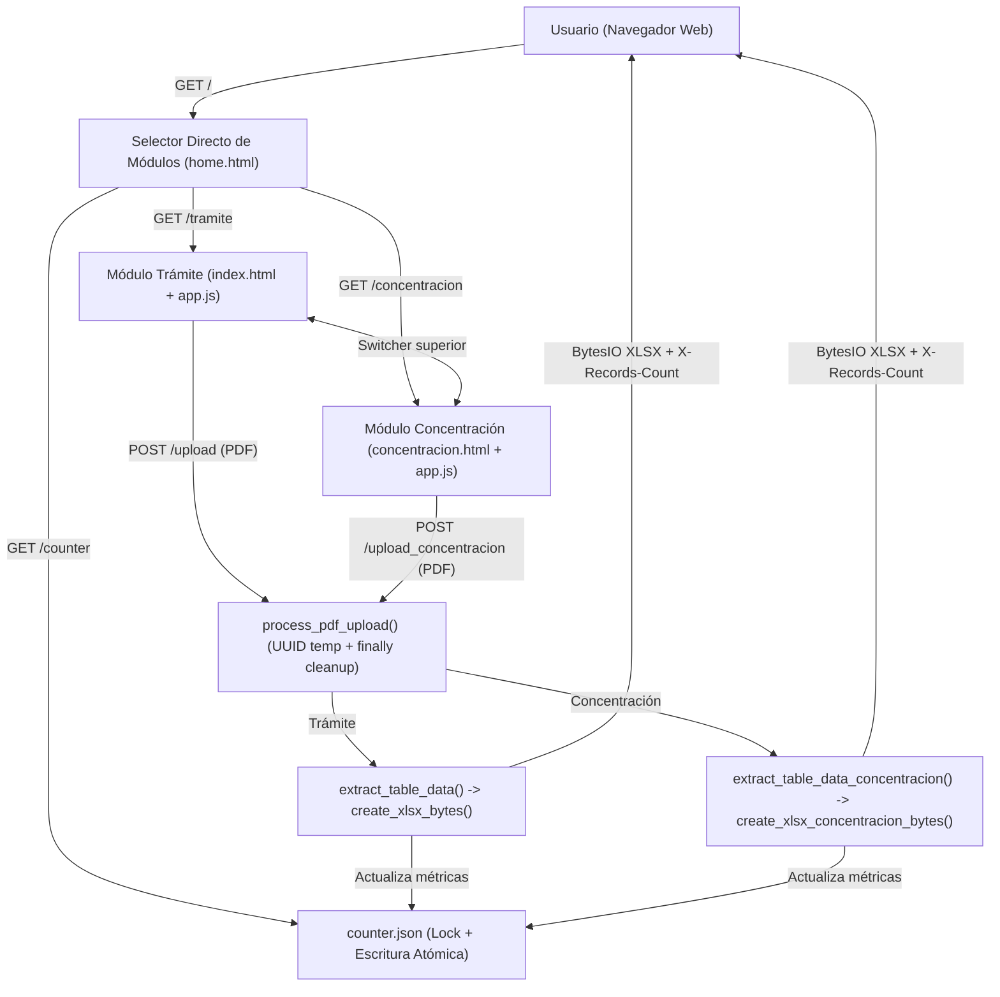

# Documentación del Sistema — Extractor SENTRE a PERGUB (`sentre_xlsx`)

## 1. Descripción General

El **Sistema de Inventarios (Extractor de PDF a Plantilla PERGUB)** es una aplicación web desarrollada para la **Contraloría Municipal del H. Ayuntamiento de Othón P. Blanco (OPB)**. Automatiza la extracción de datos tabulares desde reportes PDF generados por el sistema **SENTRE** y los convierte a hojas de cálculo Excel (`.xlsx`) compatibles con las plantillas oficiales **PERGUB**:

- **Archivo de Trámite** → Plantilla **Anexo 30** (`anexo_30_template.xlsx`).
- **Archivo de Concentración** → Plantilla **Anexo 31** (`anexo_31_template.xlsx`).

Al abrir la aplicación, el usuario elige directamente el módulo que necesita (**Archivos de Trámite** o **Archivos de Concentración**) y puede alternar entre ambos desde la barra superior sin pasos intermedios.

---

## 2. Stack Tecnológico

| Capa | Tecnología / Librería | Versión / Detalle |
| :--- | :--- | :--- |
| **Lenguaje** | Python | Entorno virtual `.venv` (Python 3.9) |
| **Framework Web** | Flask + Flask-CORS | `Flask==3.0.0`, `flask-cors==4.0.0` |
| **Servidor WSGI** | Waitress | Producción en Windows (`0.0.0.0:5000`) |
| **Extracción PDF** | `pdfplumber` | `0.10.3` (extracción de tablas por líneas y recorte por coordenadas) |
| **Generación Excel** | `openpyxl` | `3.1.2` (generación en memoria sobre plantillas `.xlsx`) |
| **Frontend** | HTML5, Jinja2, CSS3, Vanilla JS | Interfaz oscura *glassmorphism* con temas diferenciados por módulo y JS unificado |
| **Persistencia** | JSON local | `counter.json` con escritura atómica protegida por `threading.Lock` |
| **Acceso Remoto** | Cloudflare Tunnel (`cloudflared`) | Exposición temporal vía `trycloudflare.com` |

---

## 3. Estructura del Proyecto

```text
c:\dev\sentre_xlsx\
├── app.py                        # Aplicación Flask principal, extracción PDF y generación XLSX
├── requirements.txt              # Dependencias de Python
├── counter.json                  # Persistencia de contadores globales (registros y archivos)
├── anexo_30_template.xlsx        # Plantilla Excel PERGUB para Archivo de Trámite (Hoja: "Anexo 30 IAT")
├── anexo_31_template.xlsx        # Plantilla Excel PERGUB para Archivo de Concentración (Hoja: "31. AC ")
├── iniciar_app.bat               # Arranque en modo desarrollo (Flask debug=True)
├── run_server.bat                # Arranque en modo producción (Waitress en puerto 5000)
├── run_tunnel.bat                # Túnel público con Cloudflare (cloudflared)
├── SISTEMA.md                    # Documentación técnica del sistema
├── templates/
│   ├── home.html                 # Selector directo de módulos (Trámite / Concentración) + métricas globales
│   ├── index.html                # Conversor de Archivo de Trámite (tema esmeralda, Anexo 30)
│   └── concentracion.html        # Conversor de Archivo de Concentración (tema ámbar, Anexo 31)
└── static/
    ├── styles.css                # Sistema de diseño, variables de tema, animaciones y responsive
    └── app.js                    # Lógica frontend unificada parametrizada vía data-attributes
```

---

## 4. Arquitectura y Flujo de Procesamiento



### Flujo de interacción en el cliente
1. En `/` el usuario selecciona directamente **Archivos de Trámite (Anexo 30)** o **Archivos de Concentración (Anexo 31)**.
2. Arrastra o selecciona un archivo `.pdf` (validación en cliente y servidor de extensión y límite máximo de **50 MB**).
3. El frontend unificado (`static/app.js`) envía el PDF al endpoint configurado en `data-endpoint` (`/upload` o `/upload_concentracion`).
4. El backend guarda temporalmente el PDF con un nombre único (`sentre_<uuid>.pdf`), extrae y normaliza los registros, genera el `.xlsx` en memoria (`io.BytesIO`), actualiza `counter.json` de forma atómica, elimina el PDF temporal en `finally` y responde con el archivo binario + el encabezado `X-Records-Count`.
5. La vista de éxito muestra el conteo exacto de registros extraídos, el nombre del archivo generado y el botón de descarga inmediata.

---

## 5. Rutas y API HTTP

### Vistas HTML (GET)
| Ruta | Plantilla / Acción | Descripción |
| :--- | :--- | :--- |
| `GET /` | `home.html` | Selección directa entre Trámite y Concentración + contadores globales. |
| `GET /tramite` | `index.html` | Interfaz de conversión para Archivo de Trámite (Anexo 30). |
| `GET /concentracion` | `concentracion.html` | Interfaz de conversión para Archivo de Concentración (Anexo 31). |
| `GET /departamento/<slug>` | `302 Redirect -> /` | Redirección de compatibilidad para enlaces anteriores. |

### Endpoints de Procesamiento y Datos
| Método y Ruta | Parámetros | Respuesta Exitosa | Errores |
| :--- | :--- | :--- | :--- |
| `POST /upload` | `multipart/form-data`: `file` (PDF ≤ 50 MB) | `inventario_tramite_anexo30.xlsx` + header `X-Records-Count` | `400` (archivo inválido o 0 registros), `413` (> 50 MB), `500` |
| `POST /upload_concentracion` | `multipart/form-data`: `file` (PDF ≤ 50 MB) | `inventario_concentracion_anexo31.xlsx` + header `X-Records-Count` | `400` / `413` / `500` |
| `GET /status` | Ninguno | `200` JSON `{"status": "ready", "message": "Servidor listo"}` | — |
| `GET /counter` | Ninguno | `200` JSON con `total_records` y `total_files` | — |

---

## 6. Motor de Extracción y Reglas de Transformación

### 6.1 Estrategia de lectura de PDF (`pdfplumber`)
1. **Recorte vertical (Crop)**: Excluye el **28% superior** (`HEADER_PERCENT = 0.28`) y el **14% inferior** (`FOOTER_PERCENT = 0.14`).
2. **Detección de tablas**: `extract_tables` con `vertical_strategy: "lines"`, `horizontal_strategy: "lines"`, `snap_tolerance: 3`, `join_tolerance: 3`.
3. **Filtrado de encabezados**: Descarta filas que coincidan con 3 o más indicadores de encabezado de columna.
4. **Reconstrucción de registros multilínea (Trámite y Concentración)**:
   - Un entero en la primera celda (`cleaned_row[0]`) inicia un nuevo registro (`no_progresivo`).
   - Las filas subsecuentes sin entero (o con celda inicial vacía) se procesan con `append_continuation()`, concatenando texto en `clave`, `nombre`, `localizacion`/`ubicacion` y **`observacion`** (incluso cuando las observaciones tienen 2 o más saltos de línea o se parten en varias filas/páginas).

### 6.2 Limpieza y normalización (`clean_cell_text` y `normalize_records`)
- Reemplaza `\r\n`, `\r` y `\n` por espacios y colapsa múltiples espacios consecutivos.
- Elimina espacios internos en `clave`.
- Normaliza `clasificacion` (`PUBLICO`/`PÚBLICO` → `Pública`, `CONFIDENCIAL` → `Confidencial`, `RESERVADO` → `Reservada`) y `caracter` (`ADMINISTRATIVO` → `Administrativo`, `LEGAL` → `Legal`, `FISCAL` → `Fiscal`, `CONTABLE` → `Contable`).

### 6.3 Mapeo de Columnas — Archivo de Trámite (Anexo 30)
Plantilla `anexo_30_template.xlsx` (Hoja `Anexo 30 IAT`, inserción desde **fila 5**).

| Columna PDF (Índice) | Campo Interno | Columna XLSX | Encabezado Plantilla PERGUB |
| :---: | :--- | :---: | :--- |
| 0 | `no_progresivo` | A (1) | No. |
| 5 | `clasificacion` | B (2) | Clasificación |
| 1 | `clave` | C (3) | Nombre del Expediente |
| 2 | `nombre` | D (4) | Descripción |
| 6 | `caracter` | E (5) | Valor documental |
| — | *(vacío)* | F (6) | Soporte Documental |
| 4 | `localizacion` | G (7) | Ubicación |
| 3 | `mes_ano` | H (8) | Ejercicio |
| 7 | `observacion` | I (9) | Observaciones |

### 6.4 Mapeo de Columnas — Archivo de Concentración (Anexo 31)
Plantilla `anexo_31_template.xlsx` (Hoja `31. AC `, inserción desde **fila 5**).

| Columna PDF (Índice) | Campo Interno | Columna XLSX | Encabezado Plantilla PERGUB |
| :---: | :--- | :---: | :--- |
| 0 | `no_progresivo` | A (1) | No. |
| 3 | `nombre` | B (2) | Nombre del expediente |
| — | *(vacío)* | C (3) | Sección |
| 2 | `clave` | D (4) | Código |
| — | *(vacío)* | E (5) | Serie |
| — | *(vacío)* | F (6) | No. Cajas |
| — | *(vacío)* | G (7) | No. Expedientes |
| — | *(vacío)* | H (8) | Folios: Del |
| 8 | `no_hojas` | I (9) | Folios: Al |
| 10 | `ubicacion` | J (10) | Localización |
| 4 | `ano` | K (11) | Ejercicio |
| 11 | `clasificacion` | L (12) | Clasificación |
| 12 | `caracter` | M (13) | Valor documental |
| 13 | `observacion` | N (14) | Observaciones |

---

## 7. Operación

- **Producción (Recomendado)**: Ejecutar `run_server.bat` (Waitress en `http://localhost:5000`).
- **Desarrollo**: Ejecutar `iniciar_app.bat` (Flask en modo debug).
- **Acceso Remoto**: Ejecutar `run_tunnel.bat` (túnel Cloudflare hacia `http://localhost:5000`).
